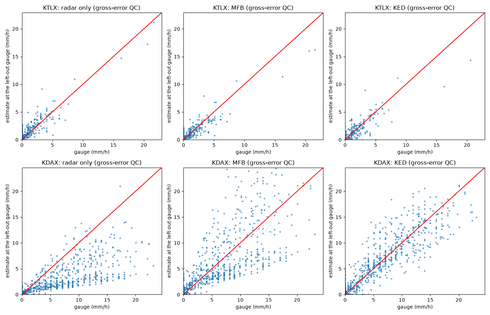
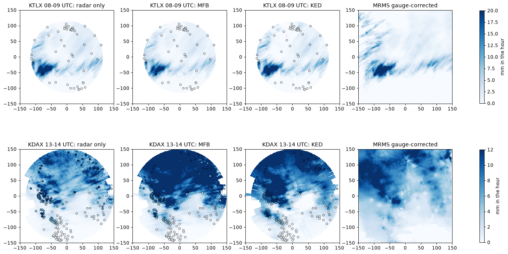

# radarwow-merging

**radar-wow stage 7: Gauge merging and uncertainty.** Radar-gauge bias adjustment, merging, ensembles.

Part of [radar-wow](https://github.com/manmeet3591/radar-wow), a set of repos that together build a radar QPE system that works for S, C and X band radars.
Every algorithm is one class implementing one paper, with the same interface: it takes an xradar sweep or volume with canonical moment names, declares the bands and moments it needs, and records provenance.

## Sub-components

| sub-component | algorithm | source | DOI | status |
|---|---|---|---|---|
| merging methods compared (MFB, Brandes, kriging, conditional merging, KED) | `merge`, `METHODS` | Goudenhoofdt & Delobbe 2009, HESS | [doi:10.5194/hess-13-195-2009](https://doi.org/10.5194/hess-13-195-2009) | implemented + notebook |
| conditional merging | `conditional_merging` | Sinclair & Pegram 2005, Atmos. Sci. Lett. | [doi:10.1002/asl.85](https://doi.org/10.1002/asl.85) | implemented + notebook |
| leave-one-out verification | `leave_one_out` | each gauge estimated from the others |  | implemented + notebook |
| RRBF / KMA, KNMI, UK schemes | - | talk |  | to review |
| commercial microwave links | - | talk (2 papers) |  | to review |

## Install

```bash
pip install git+https://github.com/manmeet3591/radarwow-core git+https://github.com/manmeet3591/radarwow-merging
```

## Notebooks (free data, S / C / X band)

- [`notebooks/01_merging_ktlx_kdax.ipynb`](notebooks/01_merging_ktlx_kdax.ipynb): open in Colab via `https://colab.research.google.com/github/manmeet3591/radarwow-merging/blob/main/notebooks/01_merging_ktlx_kdax.ipynb`

## Results




## Usage

```python
from radarwow.core import load_sample
from radarwow.merging import *  # see table above

vol = load_sample('arm_csapr2_c')        # or open_volume('my_file')
# out = SomeAlgorithm()(vol)            # band read from the file, or band='S'|'C'|'X'
```

## Status legend

*implemented + notebook*: code, tests, executed notebook. *planned*: interface fixed, code to write. *stub*: class exists, raises `NotImplementedError`. *to review*: paper to read before deciding.

## License

MIT. Data used in the notebooks comes from public archives (NEXRAD on AWS, ARM, IMD via open-radar-data) under their own terms.
